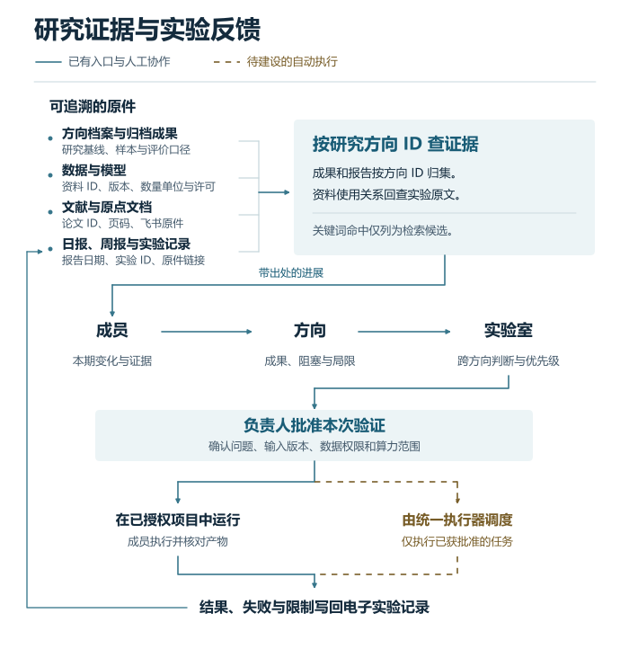

# 从研究问题到可复核的结果

成员在周会上提出一个问题，平台应能回答三件事：团队已经知道什么、证据在哪里、下一次验证还缺什么。读者沿方向、实验和原件追溯。Agent 读取同样的来源、ID、权限和适用范围。

## 学术与工程联合评审 · 2026-11-21

本次由学术方法、数据与模型、文献发现、成员协作、权限与工程五个视角评审。以下为面向当前项目的评审结论，实际的科研判断由对应工作负责人复核。

| 实际问题 | 采用的设计 | 查看依据 |
| --- | --- | --- |
| 研究问题怎样关联数据、模型和已有成果？ | 以方向稳定 ID 找基线和既有成果；成果原文明确引用的资料保留实际关联。按关键词找到的资料或论文列作候选，展示命中的词和原件入口。 | [方向档案](/progress/#directions) · [Agent 手册](agent-guide.md) |
| 有 8 个分发包，能否把原件移进公用空间？ | 文件齐备回答完整性，具名申请回答使用范围。UASpeech 的分包数量单独更新；同一团队成员不能据此取得数据使用许可。迁移须核对源与目标、许可和旧入口。 | [台账](/#feishu-ledger) · [资料读取规则](data/README.md) |
| 两个模型报出的抑郁评分误差能否直接比较？ | DepAlign 档案使用 DAIC 测试集的 PHQ-8 原始分；MMPsy 档案的 7.806/100 来自重标 PHQ-9 开发集。保留各自的目标量、划分和证据。近期用 MMPsy 做分类的 AUC 另列为一项研究。 | [科研成果](/#research) · [方向档案](/progress/#directions) |
| 同一次实验在周会、日报和周报都出现，怎样汇总？ | 固定一个实验记录或原件链接。报告引用它；成员写本期变化，方向讨论问题与限制，实验室只提炼需要共同决定的事项。每层都能回到同一原始出处。 | [进度](/progress/#team) · [研究周会模板](https://wcn5kauqqbj1.feishu.cn/wiki/CHpCw6POyiG5JFkWUGscuUmPnlh) |
| 阅读论文或文档后能否直接分发？ | 查询论文可沿 DOI、作者关键词与共同主题；题录、作者摘要、中文导读和团队实验分别标识。受限 PDF 保留访问规则。原点文档使用飞书原件实时阅读，保留文档与附件自己的权限。 | [文献管理](/papers/) · [原点文档](/#documents) |

## 共享的数据流

### 从方向到可复核的实验

成员在[方向实验台](/progress/research-agent)输入问题，服务按方向 ID 汇集已登记成果和报告，另外检索候选数据、模型和论文。可执行的协议各自指定数据版本、对照条件、计算预算和输出指标。运行结束后，团队得到一个固定链接，可展开看方法和局限、下载同一份 JSON，或在周报中引用。该页支持的两项实验分别比较录音预处理门限和文献检索字段。方向暂无匹配协议时，记录仍保留已找到的研究基础和缺口。

| 评审席位 | 需要核对的科研决定 | 可复核的产物 |
| --- | --- | --- |
| 研究方法与统计 | 实验单位是录音、参与者还是论文？对照是否使用同一批输入？ | 配对差异、分母、排除项及适用范围 |
| 数据与模型 | 原件版本、许可、真实读取能力是否支持此协议？候选模型是否实际运行？ | 数据指纹及版本；模型参与实验时另记权重版本 |
| 学术发现 | 哪些论文是检索命中，具体依据来自哪个字段？ | 文献 ID、命中字段、图谱关系和原题录 |
| 协作与复现 | 一个结果是否在多人周报中重复出现？中途失败后记录是否可追踪？ | 共用实验链接、运行状态和复核人的下一步 |

扩展一个新协议只需在实验内核登记研究问题、输入、基线、资源上限和验证样例。方向负责人先复核一个真实样本的结果，再开放给成员。实验自动生成观察，涉及因果、临床效用或泛化的判断由研究者在相应证据上作出。

下图保存首次架构评审时的方案。图中虚线涵盖的执行环节，目前已开放上述两个协议。

复核时，分别看原件的观察时间、方向档案的更新日期和总结的生成时间。发布后可从[门户静态图入口](/figures/research-infrastructure.svg)放大阅读。

<!-- 图稿验收 2026-11-21：Edge 实际渲染 700 × 722 原图及 390 像素宽嵌图，已复核中文、汇合箭头和反馈回路；30 处文字均在边界内且互不重叠，移动端无横向溢出。 -->

## 日常分工

| 维护者 | 平时做什么 | 发生变化时更新哪里 |
| --- | --- | --- |
| 数据或模型联系人 | 在原台账写清用途、版本、实际位置和共享条件 | 源表更新后验证同步结果；移动原件验收软链、文件清单与权限后再回写 |
| 实验成员 | 在项目电子实验记录写问题、输入版本、方法、划分、观察及原件路径 | 日报链接新证据；周报用四栏说明判断的变化和需要的支持 |
| 方向召集人 | 在周会上对照结果与反例，确定谁验证哪一处 | 将决定与预定复核点补到方向说明；保留仍有争议的解释 |
| 文献维护者 | 用 DOI 或来源核对题录，按论文页码核对导读 | 原件缺失或无法访问时保留题录、出处及限制；作者关键词与整理标签单列 |
| 平台及 Agent 维护者 | 维护只读接口、权限、来源指纹与失败提示 | 有新报告时重算近期摘要。大范围复盘另存版本，模型仅接收获准材料。失败沿用上次已核验版本并标明时间 |

## 上线和今后的验收

- 先用一个真实方向走通全程，例如从「通用疾病声音 Encoder」找到已有方案、成员训练记录与验证缺口，再从候选数据、模型和论文返回原件。记录哪条关联出自原文，哪条仅靠检索召回。
- 更换资料路径前，由存储维护者、资料联系人共同核实真实挂载、目录边界、许可和读者身份。迁移回执与飞书行 ID 对应，失败时原入口仍可恢复。
- 验证结论质量时每月抽查一份成员总结和一个跨方向判断。逐项检查作者、原句、数据划分和重要的阴性结果。证据不足直接保留待验证；不设按提交数或指标大小的成员排行榜。
- 新增协议时，在一个真实方向上验证完整流程。把输入版本、参数、实验结果和局限写进同一份记录，再由方向负责人决定下一轮工作。

线上状态与工作区待发布内容分开记录于[建设现状](agent-status.md)。
