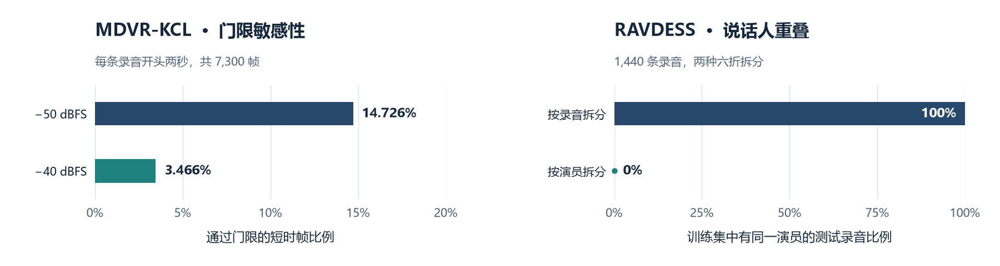

# 方向实验记录 · 录音预处理、说话人隔离与文献发现

**记录时间**　2026 年 11 月 21 日，北京时间。**执行版本**　1.0.0。**研究单位**　录音、演员和题录分别计数。两项语音实验在 47 节点的既有共享库、普通成员账户下完成。文献对照使用成员于 11 月 15 日导出的 336 条题录。[服务器实验回执](evidence/2026-11-21-direction-experiments-member.json) · [题录实验回执](evidence/2026-11-21-direction-experiments.json)



## 通用疾病声音表征 · 前处理会保留多少原始输入

MDVR-KCL 的 73 条录音均为 44.1 kHz、单声道，总时长 10,318.489 秒，单条时长中位数 141.292 秒。每条录音从起点最多取两秒，按 20 ms 无重叠分帧。对同一帧的全部声道样本按满量程归一化，计算均方能量，分别应用等价于 RMS −50 和 −40 dBFS 的门限。另根据每条 WAV 声明的帧数计算固定截取时长的覆盖比例。正式归档通过整文件 SHA-256 复核，73 条全部纳入。[经核验共享位置](2026-11-21-public-storage-audit.md) · [Hagen Jaeger、Dhaval Trivedi、Michael Stadtschnitzer 的发行记录，CC BY 4.0](https://zenodo.org/records/2867216)

7,300 个开头帧中，两种门限分别保留 **14.726% 和 3.466%**。54 条录音在两种门限下的保留率发生变化。先算每条录音的配对降幅再取中位数，结果为 **10.0 个百分点**。每条只取起始 10 秒或 30 秒，分别覆盖全库总录音时长的 **7.075% 和 21.224%**。这些结果支持把窗口选取和能量门限写入编码器实验方案。开头两秒的能量分布不足以推断整段有效语音比例。要比较下游性能，还需按受试者划分，抽查不同时间位置并加入人工标注。

## 语音情绪识别 · 两种拆分各自检验什么

从 RAVDESS Speech 正式包的 ZIP 索引读取录音、演员和情绪编码，核对 SHA-256、1,440 条唯一试次、24 位演员和 8 类情绪。用固定种子对录音 ID 的哈希排序并轮流分给六折，再用相同办法按演员分给六折。每条录音恰好进入一次测试集。只检索发行包的文件名编码，结果记录仅保留聚合数。研究者须在既有成员权限内使用此非商业资源。[成员共享授权记录](2026-11-21-conditional-dataset-rights.md) · [Steven R. Livingstone 和 Frank A. Russo 的 RAVDESS 发布及编码说明，CC BY-NC-SA 4.0](https://zenodo.org/records/1188976)

| 六折划分 | 每折测试录音数 | 测试录音中有同演员进入训练集 | 单折情绪类别占比偏离全库的最大值 |
| --- | ---: | ---: | ---: |
| 按录音 | 240 | 1,440 / 1,440（100%） | 4.583 个百分点 |
| 按演员 | 240 | 0 / 1,440（0%） | 0 个百分点 |

对于“能否识别未见说话人的情绪”这一问题，可将演员互斥的六折确定为后续评测方案。已有对照量化了同一说话人在训练和测试间的重叠。估计模型准确率及其变化仍需要实际训练和逐折评估。

## 文献发现 · 扩展检索带来多少新候选

对每个登记方向固定同一组中英文检索词，以团队目录中登记的题名作为基线。扩展组额外检索分类、标签和关键词。两组按稳定文献 ID 计数，保留命中字段范围和题录检索入口。11 月 15 日导出中的 336 条题录都有登记标题，当时的导出未含作者关键词洞察。下表各行可命中同一篇论文。

| 方向 | 题名命中 | 扩展新增 | 已登记 DOI 的命中 |
| --- | ---: | ---: | ---: |
| Daily Text Risk 日常文本风险 | 222 | 0 | 210 |
| DepAlign 抑郁程度预测 | 222 | 0 | 210 |
| MMPsy 中文文本评分 | 17 | 0 | 17 |
| 通用疾病声音 Encoder | 1 | 0 | 1 |
| 中文声音情绪识别 | 17 | 0 | 15 |

这批题录的额外字段没有带来新增命中。通用疾病声音方向尤其值得核对关键词与相关论文的用语。以上计数描述团队已有目录；方向成果、文献相关性和领域召回率各自需要独立证据。

## 复现与扩充

成员或 Agent 输入方向 ID 或主题，计划列出同 ID 成果、近期报告、候选数据、模型与文献，以及每项实验的问题、操作和参数。模型候选供核查。当前常规入口支持已验证的 MDVR-KCL 预处理和团队题录检索对照，RAVDESS 另在获准的非商业环境显式使用。实验逐项保存运行状态；缺少原件时，独立的文献对照仍可完成。

在门户模块目录中可使用成员已导出的上下文复现，并留下新的 JSON 实验原件。

```sh
python tools/run_research_experiment.py universal-voice-encoder --snapshot context.json --output voice-run.json
python tools/run_research_experiment.py "RAVDESS Speech" --snapshot context.json --noncommercial-member --output emotion-run.json
```

输出包含方向、源数据摘要、运行版本、问题、参数、起止时间、计数口径、限制和结果指纹。历史执行失败及零命中也会写入各自记录。再次复现可选新的输出文件名并核对结果指纹。补充协议时应明确一个可检验的问题、对应的台账 ID 与可用原件、比较对象、计量单位和可复核的结果；在真实输入上完成验证后才开放给成员。原件和凭据保存在既有权限范围内。
